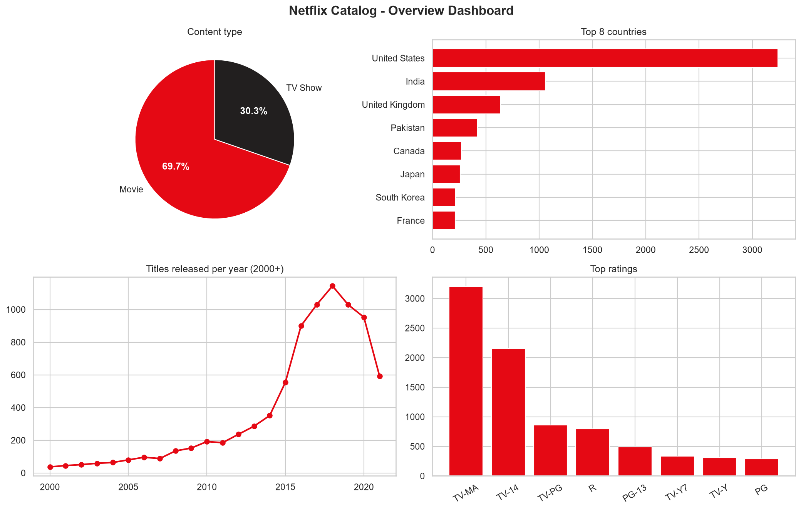
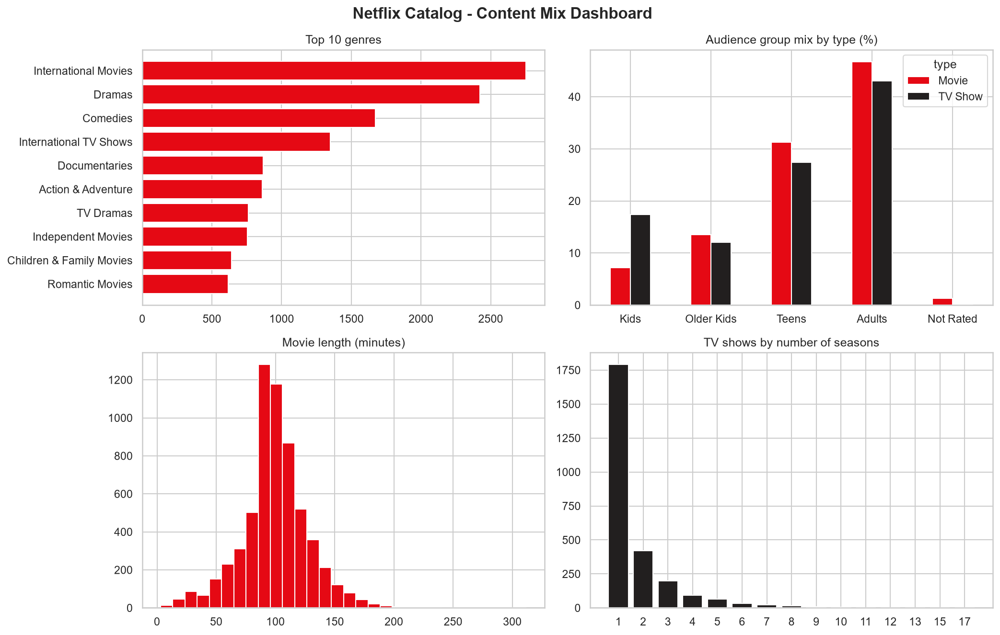

# Netflix Business Insights Report

*Source: Dataset.csv, cleaned with `task1_cleaning.py`. All figures below are calculated from the data.*

## 1. Executive summary
The catalog holds **8,786 titles**: 70% movies and 30% TV shows, from
85 countries. It is a recent library (71% released in 2015 or later), heavily
weighted to United States content and to Teen/Adult audiences. Kids content is only 10% of titles.

## 2. Key metrics
| KPI | value |
|---|---|
| Total titles | 8,786 |
| Movies | 69.7% |
| TV Shows | 30.3% |
| Countries | 85 |
| Distinct genres | 42 |
| Released 2015 or later | 71% |

## 3. Key patterns
**Where content comes from**

| Country | titles | share |
|---|---|---|
| United States | 3240 | 38.1% |
| India | 1056 | 12.4% |
| United Kingdom | 638 | 7.5% |
| Pakistan | 420 | 4.9% |
| Canada | 271 | 3.2% |

**Most common genres** (titles can carry several genres)

| Genre | titles |
|---|---|
| International Movies | 2751 |
| Dramas | 2423 |
| Comedies | 1673 |
| International TV Shows | 1348 |
| Documentaries | 869 |

**Trends.** Releases peak in 2018 (1,144 titles). Titles typically reach Netflix about
1 year(s) after release. The most recent year in the data may be incomplete.

**Format.** Median movie length is 98 minutes, and 67% of TV shows have just one season.

## 4. Dashboards

## 5. Actionable insights
1. **Grow serialized content.** TV shows are only 30% of the catalog and 67% of them stop
   after one season. Renewing or extending successful series would deepen the TV side of the library.
2. **Invest in underrepresented markets.** United States alone supplies 38% of country credits,
   and the top 3 countries about 58%. Local content in the long tail of
   82 other countries is a diversification opportunity.
3. **Expand family and kids content.** Only 10% of titles are rated for kids versus 76% for Teens or Adults,
   so family viewing is a clear gap.
4. **Double down on proven genres.** International Movies, Dramas and Comedies lead the catalog and
   can anchor new releases and recommendations.
5. **Fix metadata gaps.** Country is missing for 3% of titles and director for 29%.
   Better metadata would make future analysis and search more reliable.

## 6. Limitations
The dataset describes the catalog only. It has no viewing, revenue or audience-score data, so these insights show
what Netflix offers, not how well it performs. Genres and countries are counted per label, so totals overlap.
